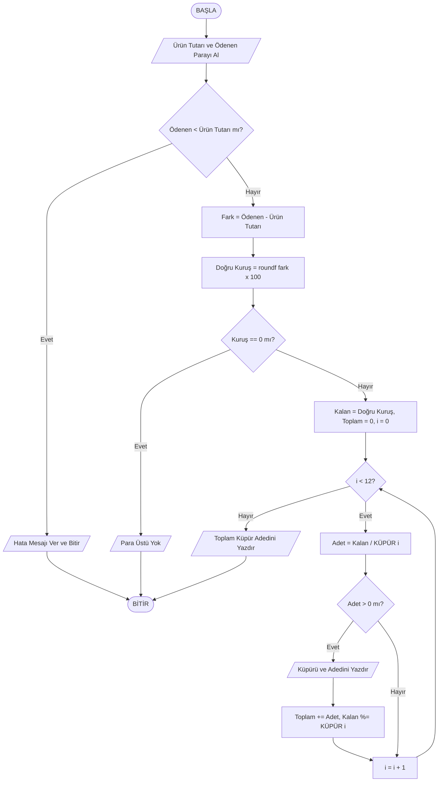

# Akıllı Kasa Para Üstü Hesaplama Sistemi ve IEEE 754 Float Hassasiyet Analizi


Bu proje, bir mağazada kasiyerin ürün tutarını ve müşterinin ödediği parayı Türk Lirası cinsinden girdiği durumda, müşteriye verilecek para üstünü **en az sayıda banknot ve madeni parayla (minimum küpür)** hesaplayan akıllı kasa yazılımıdır.

Ayrıca, bilgisayar mimarisinde ondalıklı sayıların (floating-point) ikili (binary) tabanda saklanmasından kaynaklanan **IEEE 754 hassasiyet kaybı problemini** (18.70 TL ürün, 20.00 TL ödeme senaryosu) derinlemesine analiz eder ve doğru yuvarlama çözümlerini sunar.

---

## 📌 İçindekiler
- [Projenin Amacı ve Kuralları](#-projenin-amacı-ve-kuralları)
- [Kullanılan Küpürler](#-kullanılan-küpürler)
- [IEEE 754 Float Hassasiyet Analizi (18.70 TL Örneği)](#-ieee-754-float-hassasiyet-analizi-1870-tl-örneği)
- [Algoritma ve Akış Şeması](#-algoritma-ve-akış-şeması)
- [Kurulum ve Derleme](#-kurulum-ve-derleme)
- [Kullanım ve Ekran Çıktıları](#-kullanım-ve-ekran-çıktıları)
- [Otomatik Test Paketi](#-otomatik-test-paketi)
- [Geliştirme Araçları](#-geliştirme-araçları)

---

## 🎯 Projenin Amacı ve Kuralları

Ödev isterleri doğrultusunda program şu 3 temel kurala tam uyum sağlar:

1. **Kural 1 (Veri Tipleri):** Ürün tutarı ve müşterinin ödediği para `float` değişkenlerinde tutulur. Ancak küpür ve para üstü hesabı hassasiyet kaybını önlemek için **kuruş cinsinden tam sayılarla (`int`)** yapılır.
2. **Kural 2 (Toplam Küpür Adedi):** Programın sonunda müşteriye teslim edilen toplam küpür sayısı (banknot + madeni para adedi) ekrana raporlanır.
3. **Kural 3 (Rapor ve Yuvarlama Deneyi):**
   - Para üstü hiç yuvarlama yapılmadan `(int)((odenen - urun) * 100)` formülüyle doğrudan tamsayıya çevrildiğinde:
     - Ürün tutarı: `18.70 TL`
     - Ödenen para: `20.00 TL`
     - Doğru para üstü `1.30 TL` (130 kuruş) olmasına rağmen program `129 kuruş` bulmaktadır!
   - Bu durumun matematiksel ve mimari nedeni analiz edilmiş, doğru yuvarlama yöntemi olan `roundf()` koda entegre edilmiştir.

---

## 💰 Kullanılan Küpürler

Türk Lirası sistemindeki 12 resmi küpür büyükten küçüğe sıralı olarak kullanılmıştır:

| No | Küpür Adı | Türü | Kuruş Karşılığı |
|:---:|:---|:---:|:---:|
| 1 | 200 TL | Banknot | 20000 kr |
| 2 | 100 TL | Banknot | 10000 kr |
| 3 | 50 TL | Banknot | 5000 kr |
| 4 | 20 TL | Banknot | 2000 kr |
| 5 | 10 TL | Banknot | 1000 kr |
| 6 | 5 TL | Banknot | 500 kr |
| 7 | 1 TL | Madeni Para | 100 kr |
| 8 | 50 Kuruş | Madeni Para | 50 kr |
| 9 | 25 Kuruş | Madeni Para | 25 kr |
| 10 | 10 Kuruş | Madeni Para | 10 kr |
| 11 | 5 Kuruş | Madeni Para | 5 kr |
| 12 | 1 Kuruş | Madeni Para | 1 kr |

---

## 🔬 IEEE 754 Float Hassasiyet Analizi (18.70 TL Örneği)

### Sorun: Neden 130 Kuruş yerine 129 Kuruş çıkıyor?
IEEE 754 standardında 32-bit `float` türü sayıyı ikili (binary) tabanda saklar.
$0.70$ kesri 2'lik tabana çevrildiğinde:
$$0.70_{10} = 0.10110011001100110011\dots_2$$
**Sonsuz devirli bir ikili kesir** oluşturur. 32-bit float türünün 23 bitlik mantissa (fraction) alanı bu devirli kesri tam saklayamaz ve en yakın değere yuvarlar:

- `18.70f` bellekteki değeri: `18.700000762939453125` (Hex: `0x4195999A`)
- `20.00f` bellekteki değeri: `20.000000000000000000` (Hex: `0x41A00000`)
- `20.00f - 18.70f` çıkarma işlemi: `1.299999237060546875`
- `(fark * 100.0f)` çarpımı: `129.9999237060546875`

C dilinde kayan noktalı bir sayıyı `(int)` türüne cast ettiğimizde **truncation (kırpma)** gerçekleşir. Sayının ondalık kısmı tamamen atılır:
$$\text{(int)}(129.9999237\dots) = \mathbf{129}$$

Bu nedenle müşteri **1 kuruş eksik** para üstü alır.

### Küpür Farkı
| Yöntem | Hesaplanan | Verilen Küpürler | Toplam Küpür |
|---|---|---|---|
| Yuvarlamasız `(int)` | 129 Kr | 1 TL (1), 25 Kr (1), **1 Kr (4 adet)** | **6 adet** (Hatalı & 1 kr eksik) |
| Doğru `roundf()` | 130 Kr | 1 TL (1), 25 Kr (1), **5 Kr (1 adet)** | **3 adet** (En az küpür & Doğru) |

### Çözüm
`<math.h>` kütüphanesindeki `roundf()` fonksiyonu kullanılarak en yakın tam sayıya matematiksel yuvarlama yapılır:
```c
int dogru_kurus = (int)roundf((odenen_para - urun_tutari) * 100.0f);
```

---

## ⚡ Algoritma ve Akış Şeması

Küpür seçiminde **Açgözlü (Greedy) Algoritma** uygulanmıştır. Türk Lirası kanonik (canonical) bir madeni para sistemi olduğundan, her adımda en büyük küpürün seçilmesi global minimum küpür adedini garanti eder.



---

## 🛠️ Kurulum ve Derleme

Proje GNU Make ve GCC/Clang ile standart C99/C11 formatında derlenir.

### Gereksinimler
- Linux, macOS veya Windows (WSL/MinGW)
- GCC veya Clang derleyicisi
- Make

### Derleme Komutları
```bash
# Projeyi derle
make

# Ana programı çalıştır
make run

# IEEE 754 bit düzeyindeki rapor analizini çalıştır
make rapor

# Otomatik test paketini çalıştır
make test

# Temizle
make clean
```

---

## 💻 Kullanım ve Ekran Çıktıları

### Örnek Çalıştırma:
```bash
$ ./akilli_kasa
==========================================================
               AKILLI KASA PARA USTU SISTEMI              
==========================================================
Urun tutarini giriniz (TL cinsinden, ornek: 18.70): 18.70
Musterinin odedigi parayi giriniz (TL, ornek: 20.00): 20.00

----------------------------------------------------------
                      HESAPLAMA RAPORU                    
----------------------------------------------------------
Urun Tutari        : 18.70 TL
Odenen Para        : 20.00 TL
Para Ustu (Float)  : 1.299999 TL
Para Ustu x 100    : 129.999924
----------------------------------------------------------
[1] Yuvarlamasiz Donusum (int)(fark * 100) : 129 Kurus (1.29 TL)
[2] Dogru Yuvarlama   (int)roundf(fark*100): 130 Kurus (1.30 TL)

>>> DIKKAT (IEEE 754 Hassasiyet Sorunu Tespit Edildi!):
    Ondalikli sayilar ikili (binary) sistemde saklanirken
    18.70f sayisi tam temsil edilemez (devirli ikili kesir).
    Fark register'da 1.299999... olarak saklanir.
    100 ile carpilip (int) cast yapildiginda 129.9999 sayisinin
    ondalik kismi kirpilir (truncation) ve 129 Kurus elde edilir!
    Bu durumda musteriye 1 Kurus EKSIK para ustu verilmis olur.
    Cozum olarak roundf() ile en yakin tam sayiya (130) yuvarlandi.

==========================================================
        VERILECEK EN AZ SAYIDA KUPUR LISTESI
==========================================================
  1 TL Madeni Para          :  1 adet  (  1.00 TL)
  25 Kurus Madeni Para      :  1 adet  (  0.25 TL)
  5 Kurus Madeni Para       :  1 adet  (  0.05 TL)
----------------------------------------------------------
  TOPLAM VERILEN KUPUR SAYISI: 3 adet
==========================================================
```

---

## 🧪 Otomatik Test Paketi

Proje `test_suite.sh` betiği üzerinden 6 farklı test senaryosunu otomatik olarak denetler:

```bash
$ make test
====================================================
         AKILLI KASA TEST PAKETI BASLATILIYOR       
====================================================
Test 1: Odev Ozel Ornegi (18.70 TL / 20.00 TL) ... [BASARILI]
Test 2: Tam Odeme (50.00 TL / 50.00 TL) ... [BASARILI]
Test 3: Buyuk Banknot Para Ustu (12.50 TL / 200.00 TL) ... [BASARILI]
Test 4: Kurus Kademe Testi (1.01 TL / 2.00 TL) ... [BASARILI]
Test 5: Yetersiz Odeme Dogrulamasi (30.00 TL / 20.00 TL) ... [BASARILI]
Test 6: Negatif Tutar Dogrulamasi (-5.00 TL / 10.00 TL) ... [BASARILI]

====================================================
Sonuc: 6 / 6 test basariyla tamamlandi.
====================================================
```

---

## 🛠️ Geliştirme Araçları

- **Derleyici:** GCC 11+ / Clang (`-Wall -Wextra -pedantic -std=c99 -O2`)
- **İşletim Sistemi:** Linux x86_64
- **Otomasyon:** GNU Make
- **Test Çerçevesi:** Bash Test Suite (`test_suite.sh`)
- **Versiyon Kontrol:** Git & GitHub

---

## 📄 Lisans
Bu proje açık kaynaklı olup MIT Lisansı altında sunulmuştur.
